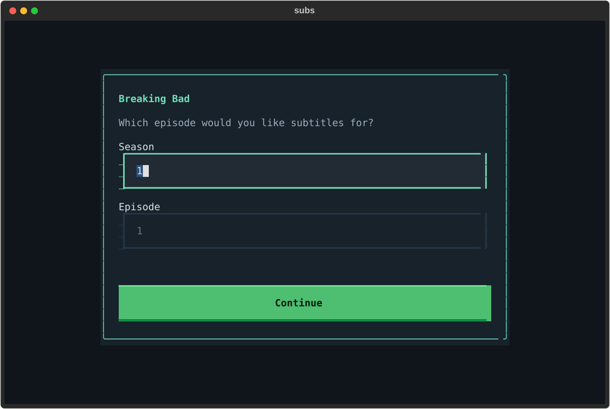

# subs

**Go to your video folder. Run `subs filename.mkv`. Pick a subtitle. Done.**

A minimal full-screen terminal app that searches multiple subtitle sources, ranks release matches, and saves a UTF-8 SRT beside your video, named so your player can discover it.

```sh
cd ~/Videos
subs "Arrival.2016.1080p.BluRay.x264-SPARKS.mkv"
# → Arrival.2016.1080p.BluRay.x264-SPARKS.en.srt
```

Use ↑/↓ to move, **Enter** or **d** to download, **/** to fuzzy-filter, **t** to correct the title, **e** to change the episode, **l** to change language, and **Esc** to go back. The selected release's match details and destination are shown below the results. A successful download closes the picker and prints the saved path.

## Install

On Arch Linux / Omarchy:

```sh
yay -S subs
```

Or install with Python 3.11+ and [uv](https://docs.astral.sh/uv/):

```sh
uv tool install git+https://github.com/sambuaneesh/subs.git@v0.1.1
```

Optional `ffmpeg` / `ffprobe` enable extraction of existing text subtitles from local videos. The AUR package uses system Python dependencies; `python-pysubs2` is also available from the AUR.

## Everyday use

```sh
subs movie.mkv                     # interactive subtitle browser
subs                              # auto-pick the only video in the current directory
subs movie.mkv -l hi               # Hindi
subs movie.mkv -l en,hi            # show both languages in the picker
subs movie.mkv --best              # download the highest-ranked usable result, no TUI
subs . --best                     # recursively process a folder, skip existing subtitles
subs "interstllar 2014"            # typo-tolerant movie title lookup
subs "Breaking Bad"                # asks for season and episode inside the TUI
subs "Breaking Bad S01E01"         # already complete: go straight to matches
subs "https://video.example/watch" # captions on a yt-dlp-supported video page
subs "URL" --auto-subs             # also offer automatic captions
subs config -l en                  # remember a default language
```

Filename paths with spaces need quotes (or normal shell tab completion). Exact paths work from any directory; output defaults to the video's own directory. For title/URL searches, output defaults to the current directory.

English is the initial default. Language names (`English`, `Hindi`), two/three-letter codes, and regional codes such as `pt-BR` work. In the TUI you choose one subtitle at a time; `--best -l en,hi` downloads one per language.

## Guided recovery

- **Show name only:** identify the show, then ask for season and episode. No episode is silently assumed.
- **Partial filename:** keep the detected season or episode and ask for the missing number. Season 0 supports specials.
- **Ambiguous name / remake:** show matching titles and years so you can choose the right version.
- **Unknown name / no results:** open a retry form. Enter another spelling, a translated title, or several alternatives separated by `|` (up to five).
- **Wrong language / episode:** press **l** or **e** and search again without leaving the app.
- **Wrong detected title:** press **t** to correct it; the original video path and sidecar filename are preserved.
- **Invalid numbers / empty names:** explain the correction in the form without losing your inputs.
- **Unavailable source / failed download:** keep the other sources and let you choose another result.
- **Video URL without captions:** **l** changes the language; **a** toggles automatic captions.



These prompts are for interactive use. `--best`, `--list`, and `--json` require enough information to identify one episode and refuse ambiguous matches.

## Matching

1. Parse the filename for title, year, season, episode, release group, source, resolution, and codec.
2. Resolve fuzzy movie/TV titles using IMDb suggestions and Cinemeta. Ask you to choose when titles are ambiguous. Explicit years distinguish remakes.
3. Search applicable subtitle sources concurrently. One unavailable source does not discard the others' results.
4. Rank compatible releases. Reject known year/episode mismatches, then prefer matching release metadata. Embedded text tracks rank first.
5. Download only the selected subtitle, validate its contents, convert to UTF-8 SRT, and save atomically.

Scores measure metadata matches, **not verified audio synchronization**. A matching release is the strongest choice. This tool does not automatically retime subtitles, transcribe audio, or extract image-based PGS/VobSub tracks. SRT conversion discards ASS styling.

## Sources

- **OpenSubtitles**, through Stremio's public subtitle addon: movies and TV, no key.
- **Gestdown / Addic7ed**: TV, no key.
- **YIFY**: movie page scraping, no key.
- **SubDL**: optional additional movie/TV source when `SUBDL_API_KEY` is set.
- **yt-dlp**: available subtitle tracks on supported video websites.
- **ffmpeg**: existing text subtitle tracks in your local file.

These are independent public services: availability, subtitle coverage, rate limits, and login requirements vary. “Any video” is not a promise that captions exist or that a site allows access. Source blocks are reported; the app does not bypass them. No account or API key is needed for the default movie/TV sources.

Source references: [Stremio addon protocol](https://github.com/Stremio/stremio-addon-sdk), [official addons](https://github.com/Stremio/stremio-official-addons), [Gestdown](https://api.gestdown.info), [YIFY](https://yifysubtitles.ch), [SubDL API](https://subdl.com/api-doc), [yt-dlp](https://github.com/yt-dlp/yt-dlp).

## More control

```sh
subs movie.mkv --title "The correct title" --year 2016
subs movie.mkv --imdb tt2543164
subs movie.mkv --provider opensubtitles,yify
subs movie.mkv --list              # plain table; no download
subs movie.mkv --json              # structured results; no download
subs movie.mkv -o ~/Subtitles      # override output directory
subs movie.mkv --force             # explicitly replace an existing subtitle
subs movie.mkv --no-cache          # fresh search
subs doctor                       # installation/source summary (does not probe connectivity)
subs --help
```

`--best` refuses ambiguous title matches and tries up to five ranked download candidates if a source fails. Batch mode reports per-file failures and exits nonzero if any requested video/language could not be handled. Multi-episode filenames are deliberately rejected: use individual episodes or a folder.

Existing files are preserved by default. ZIP archives are read in memory, size-limited, and never extracted using their paths. Episode/language checks also apply to files inside archives. HTTP error reporting omits API credentials. Search responses are cached for 15 minutes; title metadata for one day, under `$XDG_CACHE_HOME/easysubs` (normally `~/.cache/easysubs`). Preferences live at `$XDG_CONFIG_HOME/easysubs/config.json`.

For optional SubDL support, set `SUBDL_API_KEY` in your environment using your own key from SubDL. The tool doesn't store that key in its configuration or cache. Do not put it in bug reports.

## Development

```sh
uv sync
uv run pytest
uv run ruff check src tests
```

Tests use fixtures for parser, matching, archive handling, download validation, failure isolation, atomic file writes, and keyboard-driven TUI flows. Live source checks are separate from the deterministic suite.

## License

MIT © 2026 Aneesh Sambu. See [LICENSE](LICENSE).
